<!-- ===================== HEADER ===================== -->

  

  
   
  

  
  
  
  

<h2></h2>

- Estudante de **Análise e Desenvolvimento de Sistemas** na Universidade Cruzeiro do Sul
- Back-end com **Java** e **Spring Boot**
- Estudando **React** com TypeScript; também trabalho com Angular
- Experiência com integrações de marketplaces (Mercado Livre, Shopee, TikTok Shop)
- Autor do plugin **Layer Icons**, publicado no JetBrains Marketplace
- Fora do código, toco guitarra
- Procurando vaga **júnior back-end Java ou fullstack**

 

<h2></h2>

| Rank | | Stack |
|:---:|:---|:---|
|  | *Smokin' Sexy Style* | Java · Spring Boot |
|  | *Sick Skills* | PostgreSQL · TypeScript · JavaScript |
|  | *Savage* | Angular |
|  | *Apocalyptic* | React · Node.js · MySQL |
|  | *Badass* | Git · Linux · Kotlin |

  

<h2></h2>

| Projeto | Stack | O que faz |
|---|---|---|
| [Task Management API](https://github.com/EricLps/TaskListApi) | Java 21 · Spring Boot · Spring Data JPA · H2 · Docker | API REST de tarefas em camadas, com CRUD, paginação, Swagger e tratamento global de exceções |
| [Emissor de Notas Fiscais](https://github.com/EricLps/microsservicos-notas-fiscais) | C# · ASP.NET Core · EF Core · PostgreSQL · Angular | Microsserviços de estoque e faturamento via REST, com reserva temporária de estoque e controle de concorrência otimista |
| [Fornada Certa](https://github.com/EricLps/fornada-certa-web) | Java 21 · Spring Boot · PostgreSQL · Flyway · Angular | Controle de sobras de padaria: custo da perda e sugestão de produção pela média de vendas, com testes em JUnit e Mockito |

<b>Em andamento</b>

 

| | |
|---|---|
| [**pocket-wallet**](https://github.com/EricLps/pocket-wallet) | Carteira digital no estilo Pix: contas, saldo e chaves Pix · Java · Spring Boot · PostgreSQL · Angular |
| **React + TypeScript** | Reta final do curso; o próximo passo é um projeto próprio em React |

<h2></h2>

  
  

  

  

<h2></h2>

  

<!-- ===================== FOOTER ===================== -->

  

