<p align="center">
  
</p>

<p align="center">
  <a href="https://git.io/typing-svg">
    
  </a>
</p>

<p align="center">
  <a href="https://www.linkedin.com/in/eric-lopes1"></a>
  <a href="mailto:eric.lwinkelmann@gmail.com"></a>
  
</p>

---

## 🦇 Sobre mim

```java
public class Eric {
    String cargo     = "Estagiário de Engenharia de Software @ Magazine Martins";
    String formacao  = "Análise e Desenvolvimento de Sistemas — UNICSUL (12/2026)";
    String foco      = "Back-end Java: APIs REST, arquitetura em camadas, JPA";
    String noTrabalho = "Node.js + SQL: rastreio de marketplaces (Mercado Livre, Shopee, TikTok Shop)";
    String[] estudando = { "Spring Security + JWT", "Angular", "TypeScript", "Testes automatizados" };
    String objetivo  = "Desenvolvedor Back-end Júnior Java";
}
```

## 🔥 Stack

<p align="center">
  <b>Linguagens</b><br/><br/>
  
</p>

<p align="center">
  <b>Back-end & Front-end</b><br/><br/>
  
</p>

<p align="center">
  <b>Bancos de dados</b><br/><br/>
  
</p>

<p align="center">
  <b>Ferramentas</b><br/><br/>
  
</p>

## ⚔️ Projetos em destaque

| Projeto | Stack | O que faz |
|---|---|---|
| 🗂️ [Task Management API](https://github.com/EricLps/TaskListApi) | Java 21 · Spring Boot · JPA · Docker | CRUD com paginação, validações, `@ControllerAdvice` e Swagger |
| 📦 [Stock API](https://github.com/EricLps/StockApi) | C# · ASP.NET Core · EF Core · SQL Server | Controle de estoque em camadas, migrations e logs com Serilog |
| 🖼️ [Esteganografia](https://github.com/EricLps/esteganografia-java) | Java · POO | Esconde e extrai mensagens em imagens com a técnica LSB |

### 💻 Trabalhando atualmente
- 🎨 Plugin para IntelliJ que troca os ícones das classes conforme a camada (Repository, Service, Controller...)
- 💪 App fitness em Spring Boot + Angular

## 📊 Estatísticas

<p align="center">
  
  
</p>

<p align="center">
  
</p>

<p align="center">
  <picture>
    <source media="(prefers-color-scheme: dark)" srcset="https://raw.githubusercontent.com/EricLps/EricLps/output/bat-contrib-dark.svg"/>
    <source media="(prefers-color-scheme: light)" srcset="https://raw.githubusercontent.com/EricLps/EricLps/output/bat-contrib.svg"/>
    
  </picture>
</p>

<p align="center">
  
</p>

