<!-- ===================== HEADER ===================== -->

  

  
   
  

  
  
  
  

<h2></h2>

- Estudante de **Análise e Desenvolvimento de Sistemas** na Universidade Cruzeiro do Sul
- Back-end com **Java** e **Spring Boot**
- Estudando **React** com TypeScript; também trabalho com Angular
- Experiência com integrações de marketplaces (Mercado Livre, Shopee, TikTok Shop)
- Autor do plugin **Layer Icons**, publicado no JetBrains Marketplace
- Fora do código, toco guitarra
- Procurando vaga **júnior back-end Java ou fullstack**

 

<h2></h2>

| Rank | | Stack |
|:---:|:---|:---|
|  | *Smokin' Sexy Style* | Java · Spring Boot |
|  | *Sick Skills* | PostgreSQL · TypeScript · JavaScript |
|  | *Savage* | Angular |
|  | *Apocalyptic* | React · Node.js · MySQL |
|  | *Badass* | Git · Linux · Kotlin |

  

<h2></h2>

| Projeto | Stack | O que faz |
|---|---|---|
| [Task Management API](https://github.com/EricLps/TaskListApi) | Java 21 · Spring Boot · JPA · Docker | CRUD com paginação, validações, `@ControllerAdvice` e Swagger |
| [Stock API](https://github.com/EricLps/StockApi) | C# · ASP.NET Core · EF Core · SQL Server | Controle de estoque em camadas, migrations e logs com Serilog |
| [Esteganografia](https://github.com/EricLps/esteganografia-java) | Java · POO | Esconde e extrai mensagens em imagens com a técnica LSB |

**Em andamento:** app fitness com Spring Boot + Angular.

<h2></h2>

  
  

  

  

<!-- ===================== FOOTER ===================== -->

  

